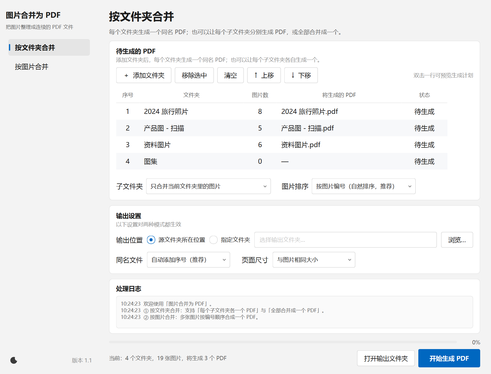
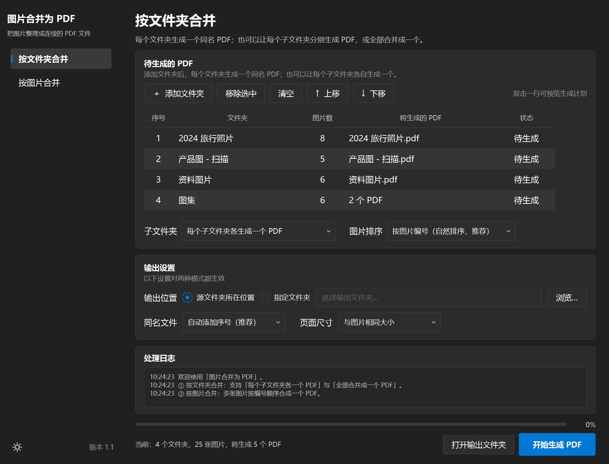
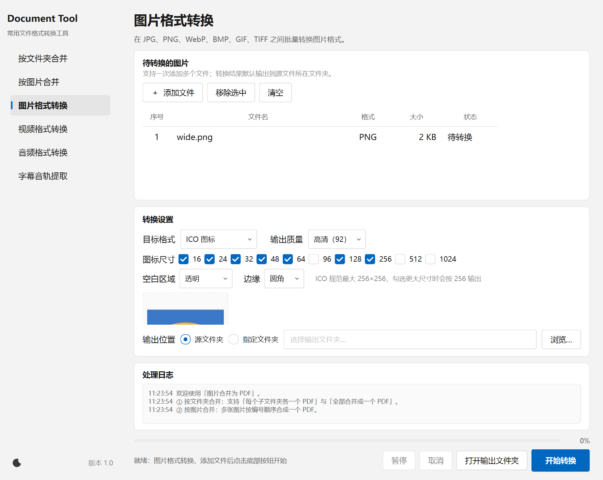
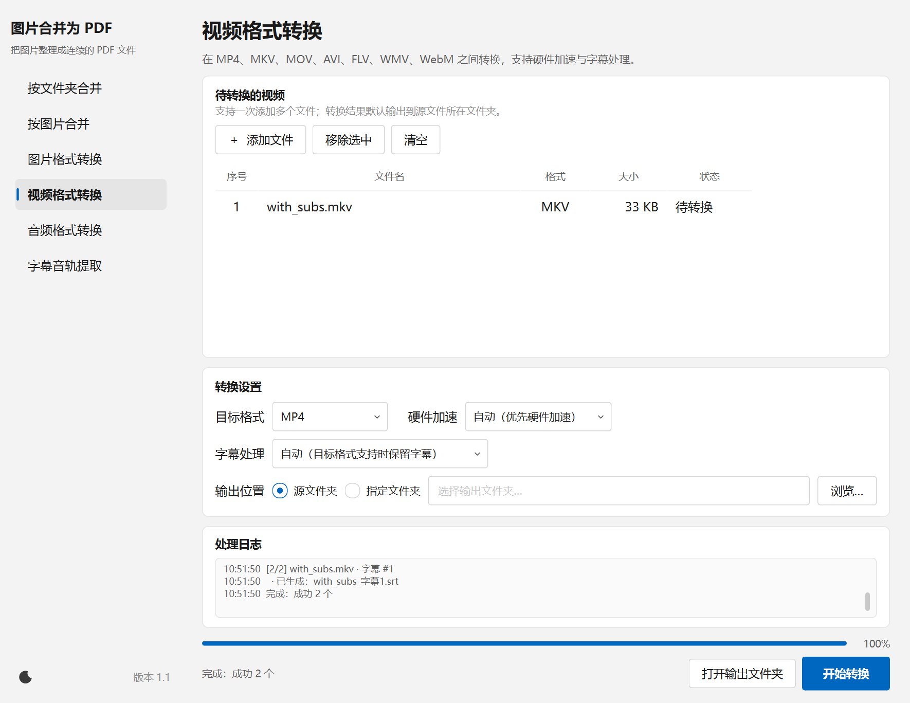
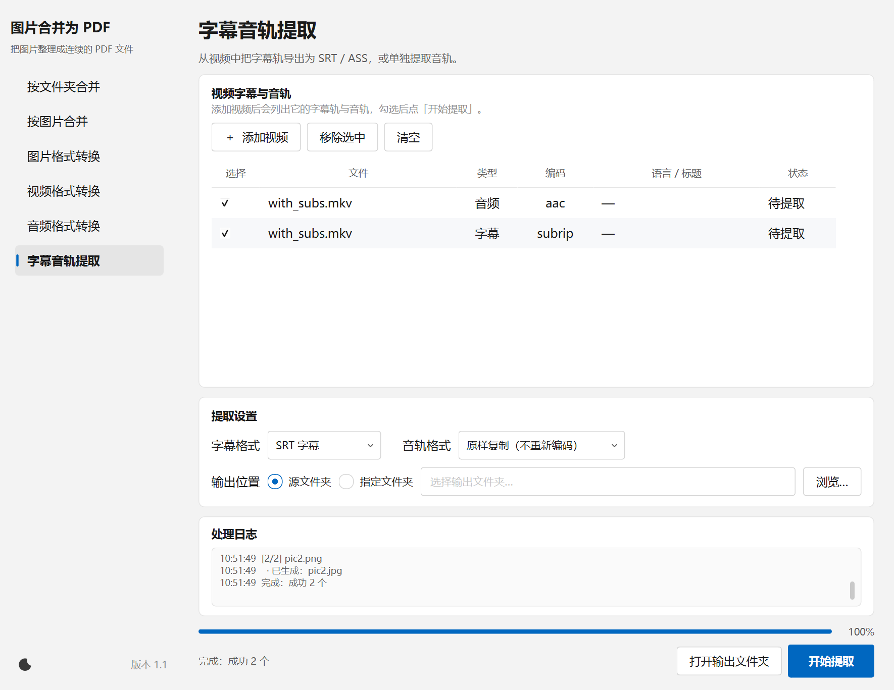

# Document Tool

一个 Windows 11 风格的桌面工具：把文件夹里的图片或随手选中的多张图片合并成连续 PDF，并支持图片 / 视频 / 音频格式转换、字幕与音轨提取。

界面采用 Win11 设置页的分组卡片与圆角控件，支持日间 / 夜间模式，左下角的太阳 / 月亮按钮点一下即可切换。





## 三种启动方式

| 方式 | 说明 |
| --- | --- |
| 双击 `Document Tool.exe` | 项目根目录的直接运行版，1 秒启动，任务栏显示应用图标 |
| 运行安装包 `installer\Document Tool 安装程序 1.0.exe` | 安装到系统，生成开始菜单 / 桌面快捷方式，分发给其他人用这个 |
| 双击 `启动 PDF 合并工具.bat` | 从源码运行，需要本机已装好依赖 |

`Document Tool.exe` 需要同目录下的 `_internal` 文件夹一起使用，移动时请把两者一起复制。

## 安装（分发给他人）

运行安装包：**`installer\Document Tool 安装程序 1.0.exe`**

- 双击安装，默认装到当前用户目录，不需要管理员权限；
- 安装包自带 Python 运行环境和 FFmpeg，**目标电脑不需要安装任何东西**；
- 卸载：开始菜单里的「卸载 Document Tool」，或 Windows 设置 → 应用 → 已安装的应用。

## 功能一：PDF 合并

### 按文件夹合并

- 一个文件夹生成一个 PDF，PDF 默认命名为文件夹名称；
- 支持一次勾选多个文件夹批量生成；
- 子文件夹三种处理方式：只合并当前文件夹 / 每个子文件夹各生成一个 PDF / 全部合并成一个；
- 图片按编号自然排序（1 → 2 → 10），也可按文件名或修改时间；
- 双击列表行可预览生成计划。

### 按图片合并

- 一次选择多张图片合并成一个 PDF，默认使用第一张图片的名称；
- 可手动调整顺序。

### PDF 生成规则

| 项目 | 默认行为 |
| --- | --- |
| PDF 命名 | 文件夹名 / 第一张图片名 |
| 输出位置 | 源文件夹所在位置（也可指定） |
| 页面尺寸 | 与图片相同；可选 A3 / A4 / A5 / B4 / B5 / Letter / Legal 或自定义毫米尺寸 |
| 同名文件 | 自动添加序号（可改为覆盖或跳过） |
| 非 JPG 图片 | 弹窗提醒后转换为 JPG 再合并，原图不受影响 |

## 功能二：格式转换

### 图片格式转换



在 JPG / PNG / WebP / BMP / GIF / TIFF 之间批量转换，可选输出质量（标准 / 高清 / 超清）。

**ICO 图标转换**：目标格式选「ICO 图标」后会出现图标设置：

- 勾选一个或多个常用分辨率（16×16 到 1024×1024；ICO 规范最大 256，更大的尺寸按 256 输出）；
- 不规则图片自动居中，空白区域可选「透明」或「白色填充」；
- 边缘可选「圆角」或「矩形」；
- 右侧实时预览当前设置的效果，改动设置立即刷新。

### 视频格式转换



- 在 MP4 / MKV / MOV / AVI / FLV / WMV / WebM 之间转换；
- **硬件加速**：自动检测 NVIDIA（NVENC）、AMD（AMF）、Intel（QSV）并实际试编码确认可用，转换时优先使用，失败自动回退软件编码；
- **字幕处理**：自动保留 / 嵌入视频 / 导出 SRT / 导出 ASS / 烧录到画面 / 忽略；目标格式不支持字幕时会自动改为烧录。

### 音频格式转换

在 MP3 / AAC / M4A / FLAC / WAV / WMA / OGG 之间批量转换。

### 转换过程控制

转换视频或音频时，底部操作栏会出现「暂停 / 继续」和「取消」按钮：

- **暂停**：冻结当前 FFmpeg 进程，进度与文件都不再变化，按钮变成「继续」，点一下从原位置接着处理；
- **取消**：立即终止当前任务，并删除未完成的半成品文件，队列里剩下的文件不再处理，状态栏显示「已取消」。

## 功能三：字幕音轨提取



添加视频后会自动列出其中的字幕轨和音轨：

- 字幕轨导出为 SRT 或 ASS（文本字幕可转；PGS、VobSub 这类图形字幕只能保留原格式，界面上不会默认勾选）；
- 音轨可「原样复制」（不重新编码、无损）或转成 M4A / MP3 / AAC / FLAC / WAV。

## 界面说明

- 左侧导航切换六个页面：按文件夹合并 / 按图片合并 / 图片格式转换 / 视频格式转换 / 音频格式转换 / 字幕音轨提取；
- 左下角月亮 / 太阳按钮一键切换深色 / 浅色模式，选择保存在 `%APPDATA%\PDFProducer\settings.json`；
- 下拉菜单、弹窗、页面切换都有过渡动画；
- 所有表格与列表使用交替行底色；底部进度条与状态实时更新，日志保留最近 600 行。

## 项目结构

```
Document Tool/
├── Document Tool.exe                  # 直接运行版（需配合 _internal）
├── _internal/                         # 运行库与资源（exe 依赖）
├── bin/                               # FFmpeg / FFprobe
├── installer/
│   └── Document Tool 安装程序 1.0.exe # 可分发的安装包
├── installer.iss                      # Inno Setup 安装脚本
├── 启动 PDF 合并工具.bat / install_deps.bat
├── main.py
├── requirements.txt
├── core/                              # PDF、格式转换、媒体处理逻辑
├── ui/                                # Win11 风格界面
├── assets/                            # 图标与图片资源
└── tests/                             # 自检脚本与界面截图
```

## 常见问题

**双击 exe 没反应？**
确认 `Document Tool.exe` 和 `_internal` 文件夹在同一目录。

**视频转换很慢？**
在「视频格式转换」页把「硬件加速」设为自动，或手动选择本机显卡对应的选项；检测不到硬件时会使用软件编码。

**转换 MP4 后字幕不见了？**
MP4 对字幕支持有限，可在「字幕处理」里选择「导出字幕文件」或「嵌入视频（自动烧录）」。

**ICO 为什么没有 1024？**
Windows ICO 规范最大 256×256，勾选 512/1024 时程序会按 256 输出。

**支持 iPhone 的 HEIC 照片吗？**
暂不支持，需要先转换成 JPG 或 PNG。

## 开发者说明

界面用 PySide6（Qt 6）编写；PDF 生成优先 img2pdf 无损写入；格式转换调用随包的 FFmpeg。

仓库不包含 FFmpeg 二进制（体积过大）。从源码运行或重新打包前，请先准备 FFmpeg：

1. 下载 Windows 版 FFmpeg：<https://www.gyan.dev/ffmpeg/builds/> 的 `ffmpeg-release-essentials.zip`；
2. 解压后把 `bin\ffmpeg.exe` 和 `bin\ffprobe.exe` 复制到项目根目录的 `bin\` 文件夹；
3. 安装 Python 依赖：`python -m pip install -r requirements.txt`。

重新打包：

```
python -m PyInstaller --noconfirm --clean --windowed --name "Document Tool" ^
  --icon "assets\icon.ico" --add-data "assets;assets" --add-data "bin;bin" ^
  --hidden-import PySide6.QtSvg main.py

ISCC.exe installer.iss
```

自检脚本：

```
python tests/test_core.py        # PDF 排序、格式转换、页面尺寸
python tests/test_options.py     # 输出路径、子文件夹模式
python tests/test_image_mode.py  # 图片模式
python tests/test_media.py       # 视频/音频/字幕/音轨核心功能
python tests/qt_smoke.py         # PDF 界面流程 + 截图
python tests/media_smoke.py      # 转换页面 + 截图
```
